# 고급자료구조  6조 너구리 게임 보고서

[**_GitHub 원격 저장소 주소_**](https://github.com/JYH-2022/Advanced_Data_Structures_Team6.git)

## 유의사항! 
**_기본 `Window cmd`와 `Visual studio` 터미널에서 인코딩 관련 실행할 때의 차이가 있는 부분이 있으므로 실행 환경에 따라서 `main `최상단에서 맞게 선택해주시길 바랍니다!_**

- **코드:**

    ```c
    int main(void){

    ...
    #ifdef _WIN32
   // 윈도우 cmd일 때:
        SetConsoleOutputCP(CP_UTF8);   <<
  
   // Visual Studio 터미널일 때:
        SetConsoleOutputCP(949);   <<
    #endif
    ...
        return 0;
        }
    ```      
---


> **개요**
> 본 보고서는 고급자료구조 과목의 **과제3 -너구리 게임**에 대한 보고서 입니다.

---

## 1. 프로젝트 개요

### 1.1. 과제 정보
- **과목명**: 고급자료구조
- **담당 교수**: 차정원 교수
- **제출일**: 2025-12-04
- **팀명**: 6조
- **과제 목표**: 초기에 제공된 너구리 게임 소스 코드(`nuguri.c`)를 분석하여 다양한 플랫폼`(Windows/Linux/Mac)`을 지원하도록 수정하고, 기존의 버그를 수정하고 몇 가지 기능들을 추가

### 1.2. 주요 학습 내용 및 구현 요약(pdf내용)
본 프로젝트를 통해 달성하고자 하는 핵심 목표와 구현 사항은 다음과 같다.

1.  **여러 플랫폼 환경 호환**: 전처리기(`#ifdef`)를 활용하여 해더파일(`conio.h`, `termios.h` 등)를 분기 처리하여 OS호환성을 확보.
2.  **자료구조 및 알고리즘**: 자료구조 및 알고리즘 응용: 2차원 배열 기반의 맵 데이터 처리, 충돌 감지 알고리즘
개선, 게임 루프 최적화를 수행한다.
3. 협업 도구 및 버전 관리: GitHub를 활용하여 개발 진행 상황을 체계적으로 기록하고
관리하는 습관을 기른다.

---

## 2. 프로젝트 관리

### 2.1. 팀원 역할 분담
모든 팀원은 전체 코드 구조를 이해하기 위해 각자 코드를 작성하는 것을 원칙으로 하되, 효율적인 진행을 위해 아래와 같이 주 담당 영역을 구분하였다.

| 이름 | 학번 | 담당 역할 |
| :---: | :---: | :--- |
| **김민재** | 20253158 | `move_player()` 함수 내 점프, 사다리 로직 변경 <br>`load_maps3()` 동적 맵 할당 구현<br>`free_maps()` 메모리 해제 함수 구현|
| **정이량** | 20222017 | `opening()` 오프닝 화면 추가 <br> `ending()` 엔딩화면 추가<br> `reset_game()` 재시작 또는 나가기 선택지 추가|
| **조예현** | 20223140 | `collision_count` 이용하여 생명력 기능 추가 <br> 윈도우 방향키 가능하게 수정 <br>맵 설계 및 전체적인 로직 개선|
| **선지수** | 20243111 |`enable_ansi()` windows에서 ANSI 호환 확보(_구현_) <br>`#ifdef...endif`헤더파일 구분 작업<br> `play_nextstage_sound` 등 효과음 구현(_스테이지 통과, 사망 시_) |


---

## 3. 개발 환경 및 실행 방법

### 3.1. 개발 도구
- **통합 개발 환경**: **_Visual Studio Code_**,  **_Visual Studio 2022_**,  **_Xcode_**
- **컴파일러**: **_GCC_**, **_MinGW_**, **_MSVC_**, **_clang_**
- **협업 도구**: **_HackMD_**, **_GitHub_**, **_Discord_** (_소통 메신저_)

### 3.2. 실행 방법

#### 윈도우 환경 (Windows)
* 8.1.0 이상 버전의 gcc 컴파일러와 MinGW-CMake 를 설치한다.
* 컴파일러 설치 후, 시스템 환경 변수 `Path`에 ~/mingw64/bin 폴더를 추가한다.
* `nuguri.c` 파일이 있는 폴더에서, 윈도우 cmd에 다음 명령어를 입력한다.
1. `gcc nuguri.c -o nuguri.exe`
2. `nugrui.exe`
>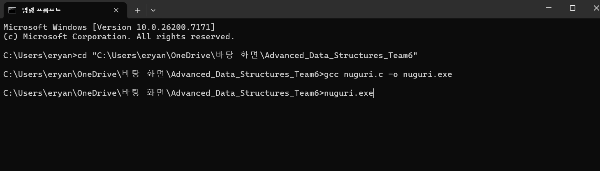


> **실행 화면 예시:**
> 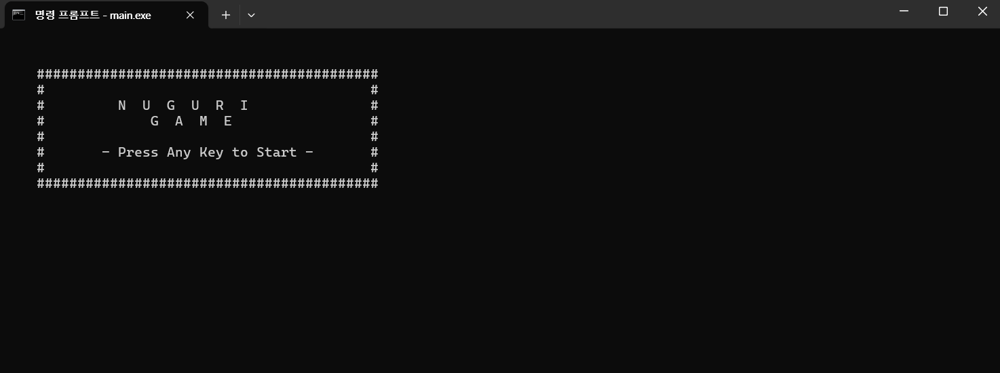


#### 맥 환경 (macOS)
[여기에 리눅스나 맥 환경 실행 방법을 적으세요]
1. `gcc nuguri.c -o main`
2. `./main` 실행

> **실행 화면 예시:**
> 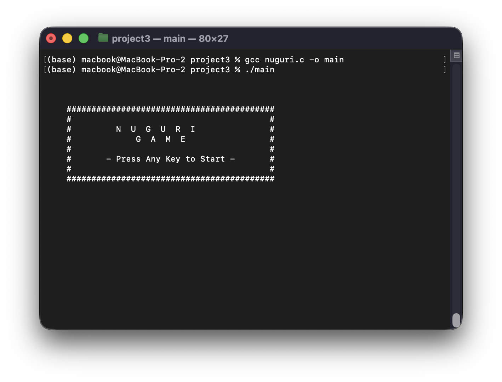


#### 리눅스 환경 (Linux)
[여기에 리눅스나 맥 환경 실행 방법을 적으세요]
1. `gcc nuguri.c -o main`
2. `./main` 실행

> **실행 화면 예시:**
> 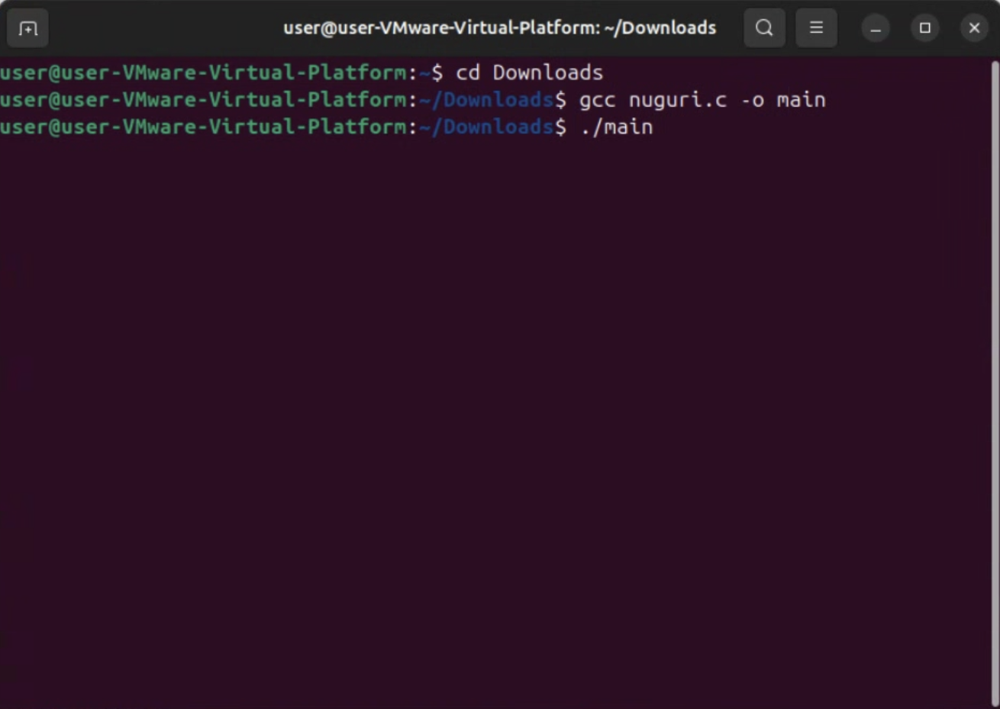

---

## 4. 핵심 구현 내용

다음은 본 프로젝트에서 구현한 핵심 기능들의 목록입니다.

| 번호 | 구현 기능 | 주요 내용 |
|:---:|:---|:---|
| **1** | **크로스 플랫폼 지원** | Windows와 Linux/Mac 환경 감지 및 전용 헤더 파일 적용 |
| **2** | **맵 파일 로딩** | `map.txt` 파일을 읽어 2차원 배열에 저장하고 화면에 표시 |
| **3** | **생명력 시스템** | 적 충돌 시 생명력 감소 및 위치 초기화, 0이 되면 게임 오버 처리 |
| **4** | **장면 전환** | 타이틀 화면, 엔딩 화면(성공/사망)|
| **5** | **효과음 구현** | 점프, 사망, 탈출 시 효과음 | 
| **6** | **재시작 또는 나가기** | 재시작 및 나가기 추가, 재시작 시 전역변수 초기화|
---

### 구현 1: 크로스 플랫폼 지원

-   **주요 로직:**
    1.  `#ifdef _WIN32` 전처리기를 사용하여 OS를 판별합니다.
    2.  Windows에서는 `conio.h`와 `windows.h`를, Linux에서는 `termios.h`와 `unistd.h`를 포함시킵니다.

-   **코드 :**
    ```c
    ...
    #ifndef _WIN32
    #include <termios.h>
    #include <fcntl.h>
    #include <unistd.h>
    #else
    #include <windows.h>
    #include <conio.h>
    #endif
    ...
    #ifndef _WIN32
            usleep(90000);
    #else
            Sleep(90);
    #endif
    ```
    * 윈도우는 windows.h의 Sleep() 함수, 리눅스와 맥은 unistd.h의 usleep() 함수를 이용합니다.

---
### 구현 2: 맵 파일 로딩

-   **주요 로직:**
    1.  `fopen`으로 `map.txt` 파일을 엽니다.
    2.  `fgetc`로 한 글자씩 읽으며 행렬의 크기를 측정합니다.
    3.  동적 할당하며 저장합니다.

-   **코드 :**
    ```c
    void load_maps3(FILE *file) {
        if (!file) {
            perror("map.txt 파일을 열 수 없습니다.");
            return;
        }
        free_maps();
        long long int data_count = ftell(file);
        int x = 0, y = 0, max_x = 0, max_y = 0;
        char ch;
        while (1) {
            //...파일 크기 읽기
        }
        maps = (char**)malloc(sizeof(char*) * max_height);
        if (maps == NULL) return;
        //...파일 위치 이동
        clrscr();
        for (int ty = 0; ty < max_y; ty++) {
            maps[ty] = (char*)malloc(sizeof(char) * (max_width + 3));
            if (maps[ty] == NULL) {
                free_maps();
                return;
            }
            while (fgets(maps[ty], max_width + 3, file) != NULL) {
                char temp_c = maps[ty][0];
                if (!(temp_c == '\n' || temp_c == '\r')) break;
            }
        }
    }
    ```
-   **실행 결과:**
    -   **스크린샷:**
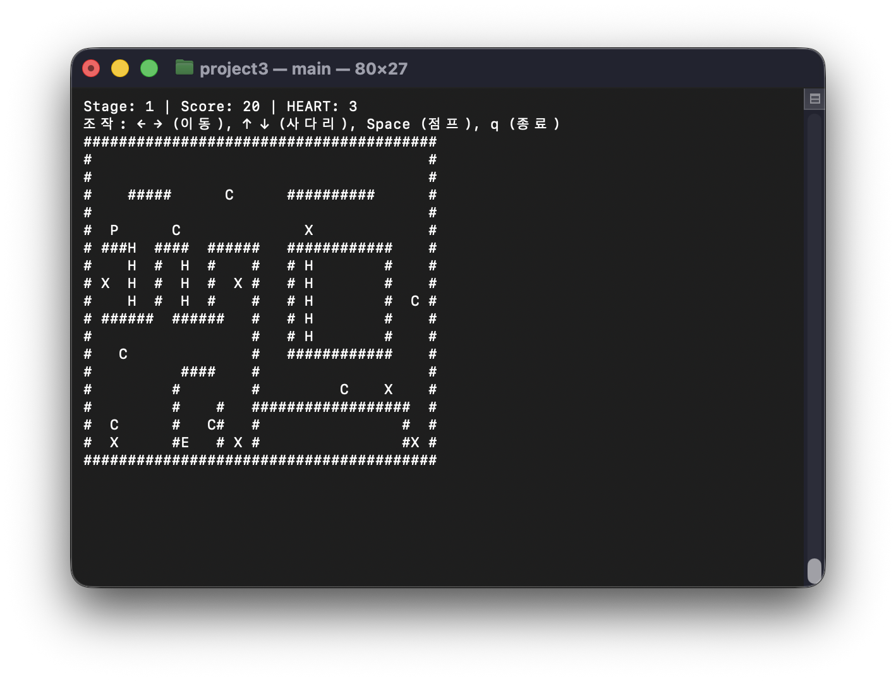

---
### 구현 3: 생명력 시스템

-   **주요 로직:**
    1.  전역 변수 `lives`를 선언하고 초기값을 3으로 설정합니다.
    2.  적과 충돌 시 `lives`를 감소시킨다.
    3.  감소시킨 후에도 `lives` 값이 0보다 크면 시작 위치(`start_x`, `start_y`)로 되돌리고 0이 되면 게임 오버를 출력한다.

-   **코드 :**
    ```c
    int collision_count = 0; // 전역변수

    void check_collisions(void) {
    for (int i = 0; i < enemy_count; i++) {
        if (player_x == enemies[i].x && player_y == enemies[i].y) {
            play_death_sound();
            collision_count++;
            score = (score > 50) ? score - 50 : 0;
            clrscr();
            init_stage();
            return;
        }
    }
    }
        
        void draw_game(void) {
            printf("\x1b[H"); // 커서를 맨 위로 이동 (덮어쓰기)
            printf("Stage: %d | Score: %d | HEART: %d\n", curr_stage + 1, score, 3 - collision_count);
            printf("조작: ← → (이동), ↑ ↓ (사다리), Space (점프), q (종료)\n");
        }
            
    ```
-   **실행 결과:**
    -   **스크린샷:**
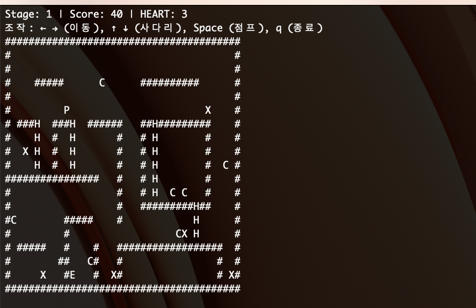
**_남은 생명 1로 변경_**
↓↓↓↓↓↓↓↓↓↓↓↓↓
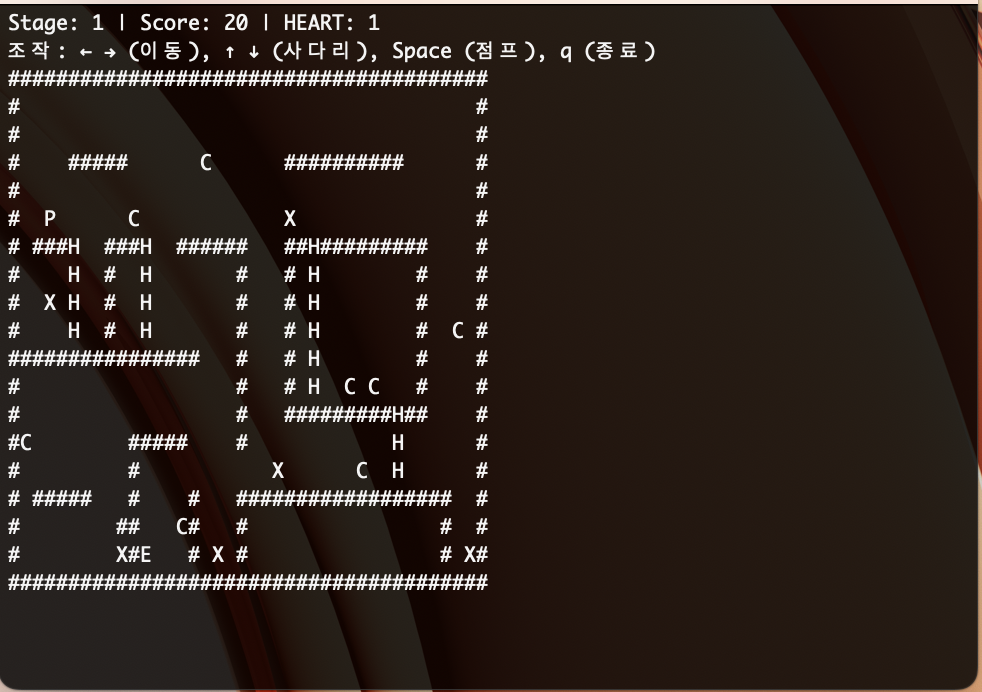


---
### 구현 4: UI 장면 전환

-   **주요 로직:**
    1. 게임 시작 시`void opening()` 함수를 호출합니다.
     
        - **코드:**

            ```c
            void opening(void) {
            // 화면 잔상 제거
            clrscr();
            printf("\n\n");
            printf("    ##########################################\n");
            printf("    #                                        #\n");
            printf("    #         N  U  G  U  R  I               #\n");
            printf("    #             G  A  M  E                 #\n");
            printf("    #                                        #\n");
            printf("    #       - Press Any Key to Start -       #\n");
            printf("    #                                        #\n");
            printf("    ##########################################\n");
            printf("\n");
            }
            ```

        -   **실행 결과:**
            -   **스크린샷:**
        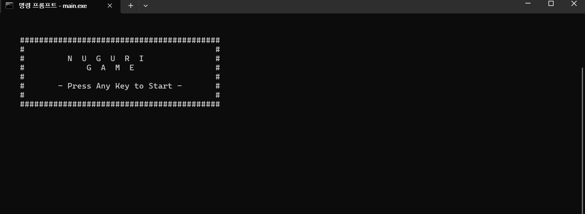
 


-   **주요 로직:**
     2.  게임 종료 시`void ending()` 함수를 호출합니다.
     
    -   **코드 :**
        
        ```c
        int ending(int result) {
            // 화면 잔상 제거
            ...
            printf("    ##########################################\n");
            printf("    #                                        #\n");
            if (result == 1) {
                printf("    #    C O N G R A T U L A T I O N S       #\n");
                printf("    #         ALL STAGES CLEARED!            #\n");

            }
            ...
            printf("    #                                        #\n");
            printf("    #        FINAL SCORE: %-5d              #\n", score);
            printf("    #                                        #\n");
            printf("    ##########################################\n");
            printf("\n");
            printf("     Press 'r': Restart / 'q': Quit \n");
           ...
               
        }
          ```
          -   **실행 결과:**
            -   **스크린샷:**
         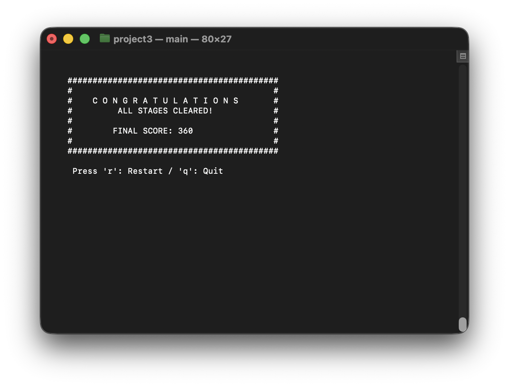
        
     3.  사망 시`void ending()` 함수를 호출합니다.
    - 코드:
         ```c
            ... 
            else {
            printf("    #           G A M E   O V E R            #\n");
            printf("    #           Try Again ...                #\n");
        }
            printf("    #                                        #\n");
            printf("    #        FINAL SCORE: %-5d              #\n", score);
            printf("    #                                        #\n");
            printf("    ##########################################\n");
            ...
        ```

     -   **실행 결과:**
            -   **스크린샷:**
         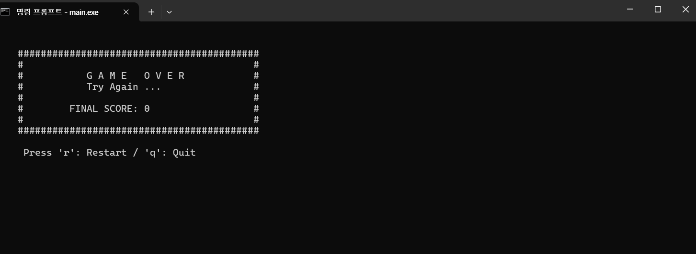


### 구현 5: 효과음 구현

-   **주요 로직:**
    1.  `Beep()`을 통해 윈도우에서 소리를 구현합니다.
    2.  `printf("\a")`를 통해 Apple(mac) 및 리눅스 등에서의 효과음을 구현합니다.
    * 단순히 실행 중인 OS의 경고음을 출력하는 `\7`(BELL) 과 달리, 소리의 높낮이(Hz)와 길이(ms)를 조절할 수 있는 `Beep()` 특성상 Windows에서는 효과음을 더 다채롭게 만들 수 있다.

-   **코드 :**
    * 점프 효과음
    ```c
    void play_jump_sound(void) {
    #ifdef _WIN32 // Windows 코드
        Beep(800, 10); 
    #else //macOS, Linux 코드
        printf("\7");
        fflush(stdout);
    #endif
    }
    ```
    * 사망 효과음
    ```c
    void play_death_sound(void) {
    #ifdef _WIN32
        Beep(220, 100);
        Beep(220, 100);
        Beep(220, 100);  // 삐비빅 (...)
    #else
        printf("\7");
        fflush(stdout);
    #endif
    }
    ```
    * 스테이지 클리어 효과음
    ```c
    void play_nextstage_sound(void) {
    #ifdef _WIN32
        Beep(440, 50);
        Beep(660, 150);  // 삐빅 (-^)
    #else
        printf("\7");
        fflush(stdout);
    #endif
    }
    ```
### 구현 6: 재시작 또는 나가기

-   **주요 로직:**
    1.  클리어 하거나 사망한 경우 r키를 입력해 게임을 다시 시작할 수 있게 하는 `ending()`함수 구현

-   **코드 :**

    ```c
    int main{
        while(!game_over && curr_stage != -1){
            if (collision_count >= 3) {
                restart=ending(0); //사망시 ending 호출
                break;
            }

            if (maps[player_y][player_x] == 'E') {
                play_nextstage_sound();
                curr_stage++;
                load_maps3(file);
                if (curr_stage != -1) {
                    score += 100;
                    init_stage();
                    clrscr();
                } else {
                    restart = ending(1); //클리어시 ending 호출
                    break;
                }
            }
        }
    }
    int ending(int result) {
        
          ...
        printf("\n");
        printf("     Press 'r': Restart / 'q': Quit \n");

        while(1) {
        #ifndef _WIN32
            char c = getchar();
        #else
            char c = getch();
        #endif
            if (c == 'r' || c == 'R') return 1;
            else if (c == 'q' || c == 'Q') return 0;
        }
    }
    ```
---

## 5. 문제 해결 

프로젝트 진행 중 발생한 주요 오류와 해결 과정을 **게임 로직, 코드 로직, 호환성** 등의 카테고리로 분류하여 정리하였다.

### 문제 요약 

| 번호 | 문제 현상 | 원인 | 해결 방법 |
|:---:|:---|:---|:---|
| **1** | **윈도우에서 한글 인코딩 깨짐 및 맵 로딩 오류** |한글로 구성된 안내문(_방향키 안내, 종료 등_)이 윈도우에서 깨지면서 출력<br><br>Windows의 줄바꿈 문자(`\r\n`) 처리 미흡 | `main` 상단에 `SetConsoleCP(UTF-8)`(**_cmd기준_**), 또는 `SetConsoleCP(949)`(**_Visual Studio기준_**)로 해결 <br><br>파일을 바이너리 모드로 열어 읽은 후, 읽기 전과 읽은 후의 파일 위치 차이만큼 `fseek`를 사용하여 처리합니다.|
| **2** | **화면 깜빡임** | `system("cls")` 속도 및 `커서` 깜빡임 문제 | 윈도우에서도(_윈도우 10 이상일 때_ ) `ansi escape` 활성화 | |
| **3** | **플레이어 이동 관련** | 점프가 `2,1,0,-1,-2 ...`로 증가 되면서 장애물이나 벽이 있어도 이동됨.<br>좌우로 움직일 때 `floor_tile`을 갱신하지 않아 벽에 끼일 수 있음.  | `move_player()` 로직 수정 |


---

### 5.1. [호환성 문제]

#### 5.1.1. OS별 헤더 파일 및 함수 부재

-   **문제 현상:** Windows 환경(Visual Studio, gcc)에서 컴파일 시도 시 `<unistd.h>`, `<termios.h>`를 찾을 수 없다는 에러와 함께 컴파일 불가능
    -   **상세 설명:** 해당 헤더들은 POSIX 표준(리눅스/유닉스) 라이브러리로 윈도우에서는 지원하지 않음. 이에 대한 전처리가 필요.
        -   **수정 전 코드 (Before):**
            ```c
            #include <unistd.h>
            #include <termios.h>
            // Linux 전용 코드를 그대로 사용
            ```
        -   **수정 후 코드 (After):**
            ```c
            #ifdef _WIN32 //if defined(_WIN32)
                #include <conio.h>
                #include <windows.h>
            #else
                #include <unistd.h>
                #include <termios.h>
            #endif
            // 헤더 파일 구분
            ```


#### 5.1.2 맵 데이터 깨짐 현상

-   **문제 현상:** 맵을 로드했을 때 맵의 오른쪽 끝이 밀리거나 이상한 문자가 출력됨.
    -   **상세 설명:** Windows 텍스트 파일은 줄바꿈이 `\r\n`이고 Linux는 `\n`임. `fgets`가 `\r`까지 읽어들여 맵 배열에 포함시키면서 발생.
        -   **수정 전 코드 (Before):**
            ```c
            FILE* file = fopen("map.txt", "r");
            ```
        -   **수정 후 코드 (After):**
            ```c
            FILE* file = fopen("map.txt", "rb");
            ```

---

### 5.2. [화면 깜빡임]

#### 5.2.1 화면 지우기 호환성

-   **문제 현상:** Windows 구 버전 환경에서 화면이 갱신될 때마다 이전 화면이 남거나 이상한 문자가 출력됨.
    -   **상세 설명:** ANSI Escape Code(`\033[2J`)가 윈도우 구형 콘솔(cmd.exe)에서는 제대로 해석되지 않아 문자로 출력됨.
        -   **수정 전 코드 (Before):**
            ```c
            printf("\x1b[2J\x1b[H");
            ```
        -   **수정 후 코드 (After):**
            ```c
            // 소스코드 상단에 ANSI 이스케이프를 사용할 수 있게 하는 함수 작성
            // 가상화 터미널 처리 플래그를 추가
            #ifdef _WIN32
            void enable_ansi(void) { 
                HANDLE hConsole = GetStdHandle(STD_OUTPUT_HANDLE);
                DWORD dwMode = 0;
                GetConsoleMode(hConsole, &dwMode);
                dwMode |= ENABLE_VIRTUAL_TERMINAL_PROCESSING;
                SetConsoleMode(hConsole, dwMode);
            }
            #endif

            // ...

            #ifdef _WIN32  // (macOS/Linux는 이 함수가 필요없으므로)
            enable_ansi();
            #endif

            // ...

            printf("\x1b[2J\x1b[H");
            ```

---

### 5.3. [플레이어 이동 관련 문제]
#### 5.3.1 플레이어 이동

-   **주요 로직:**
    1.  `velocity_y` 변수를 이용해서 현재 속도에 따라 1칸 씩 올라갔다가 다시 내려오는, '점프'를 구현합니다. 또한 조건문을 추가해서 장애물 및 벽 위로 점프되는 오류를 방지합니다.
    2.  `a` 또는 `d` 키를 이용하여 이동할 경우 대각선 아래로 움직일 수 있는 문제를 해결하기 위해 `floor_tile` 변수 값을 이동 후에 재설정합니다.
    3.  `w` 키를 이용하여 사다리를 올라갈 경우 위에 벽이 있을 때 통과되도록 수정하였습니다.
    4.  사다리 위에서 사다리 아래로 내려갈 수 있도록 로직 수정
    5.  떨어질 때 바닥에 닿지 않아도 점프가 되는 버그 해결

-   **코드 :**
    ```c
      //플레이어 이동 로직을 처리하는 함수
    void move_player(char input) {
        // 플레이어 이동 로직 (기존 유지)
        int next_x = player_x, next_y = player_y;
        char floor_tile = (player_y + 1 < max_height) ? maps[player_y + 1][player_x] : '#';
        char current_tile = maps[player_y][player_x];

        on_ladder = (current_tile == 'H');

        switch (input) {

            case 'a': next_x--; break;
            case 'd': next_x++; break;
            case 'w': if (on_ladder) next_y--; break;
            case 's': if (player_y + 1 < max_height) next_y++; break;
            case ' ':
                if (!is_jumping && (floor_tile == '#' || on_ladder || floor_tile == 'H')) {
                    is_jumping = 1;
                    velocity_y = -3;
                    play_jump_sound();
                }
                break;
        }

        if (next_x >= 0 && next_x < max_width) {
            if (maps[player_y][next_x] != '#') {
                player_x = next_x;
                floor_tile = (player_y + 1 < max_height) ? maps[player_y + 1][player_x] : '#';
            }
        }

        if (input == 'w' || input == 's') {
            if(on_ladder){
                if (maps[next_y][player_x] != '#') {
                    if((next_y >= 0 && next_y < max_height)){
                        player_y = next_y;
                    }

                }
                else if(input == 'w'){
                    next_y = player_y + (next_y - player_y)*2;
                    if(next_y >= 0 && next_y < max_height){
                        player_y = next_y;
                    }
                }
                is_jumping = 0;
                velocity_y = 0;
            }
            else{
                if (input == 's' && floor_tile == 'H'){
                    player_y = next_y;
                }
            }
            floor_tile = (player_y + 1 < max_height) ? maps[player_y + 1][player_x] : '#';
        }
        else {
            if (is_jumping) {
                next_y = player_y + ((velocity_y >= 3) ? 1 : -1);
                if (next_y < 0) next_y = 0;
                velocity_y++;
                if (velocity_y >= 1 && velocity_y <= 3) return;
                if (next_y < max_height) {
                    if (maps[next_y][player_x] == '#') {
                        if (velocity_y <= 0) {
                            if (!on_ladder) velocity_y = 0;
                          /*else if (velocity_y <= -2) {
                             if(next_y - 1 >= 0 && maps[next_y - 1][player_x] != '#'){
                                    player_y = next_y - 1;
                                    is_jumping = 0;
                               }
                            }//점프로 사다리 올라가기 대신 화살표키로 변경.*/
                        }
                        else if (velocity_y > 0) is_jumping = 0;
                    }
                    else if(maps[next_y][player_x] == 'H'){
                        is_jumping = 0;
                    }else{
                        player_y = next_y;
                    }
                }
                if ((player_y + 1 < max_height) && maps[player_y + 1][player_x] == '#') {
                    is_jumping = 0;
                    velocity_y = 0;
                }
            }
            else {
                if (floor_tile != '#' && floor_tile != 'H' && !on_ladder) {
                    if (player_y + 1 < max_height) player_y++;
                    else init_stage();
                }
            }
        }
        if (player_y >= max_height) init_stage();
    }
    ```
    

---
## 6. 게임 실행 화면
### 6.1 시작 화면
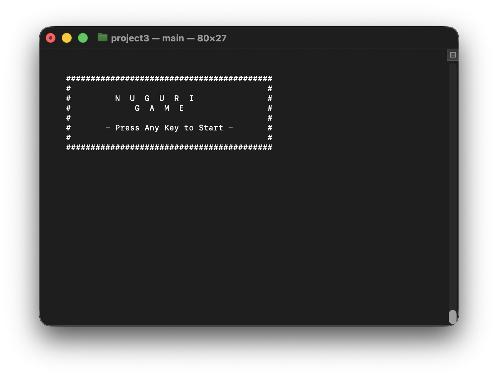

---
### 6.2 첫 번째 스테이지
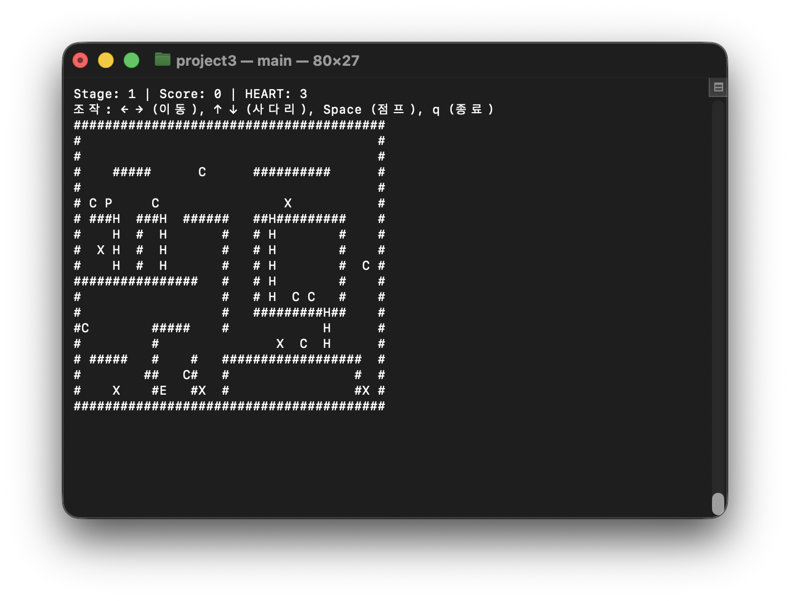

---
### 6.3 두 번째 스테이지
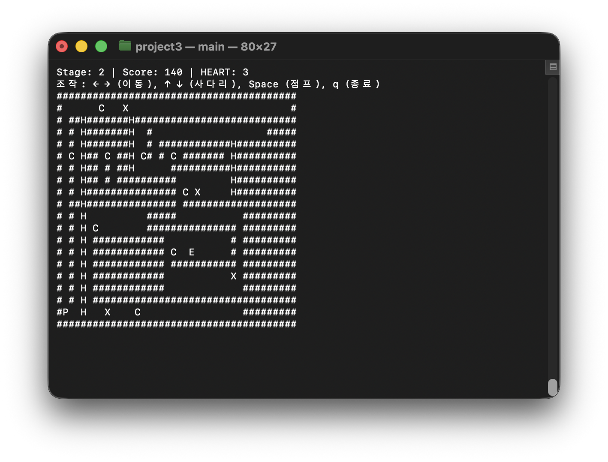

---
### 6.4 세 번째 스테이지
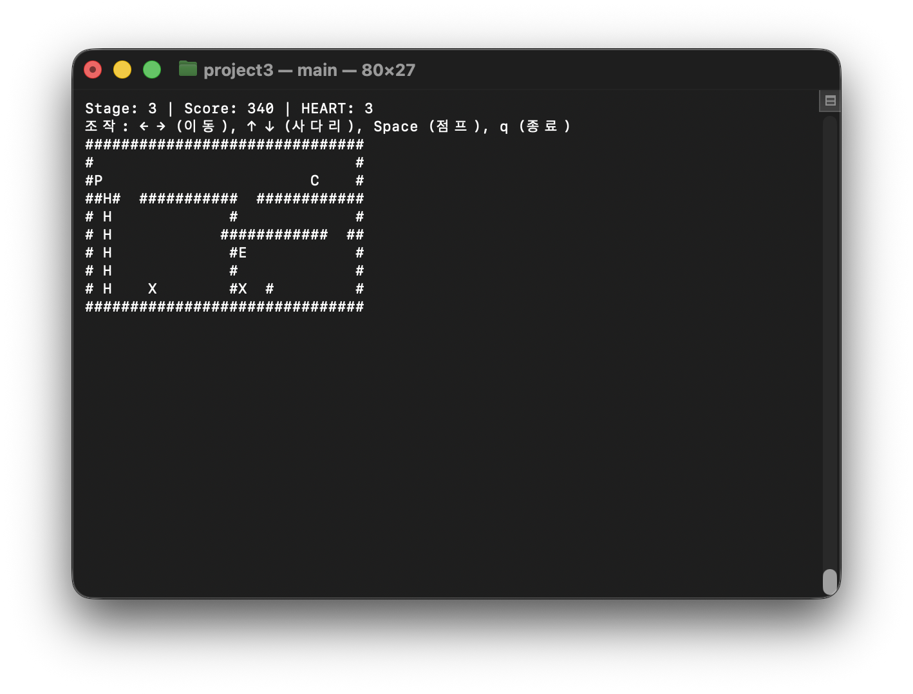

---
### 6.5 네 번째 스테이지
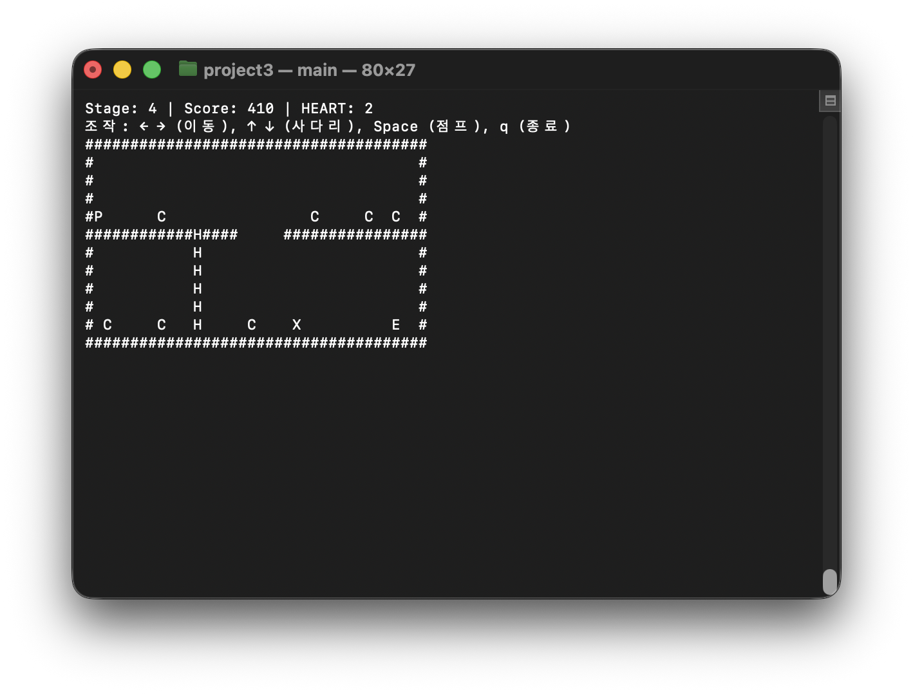

---
### 6.6 클리어 화면


---
### 6.7 사망 화면
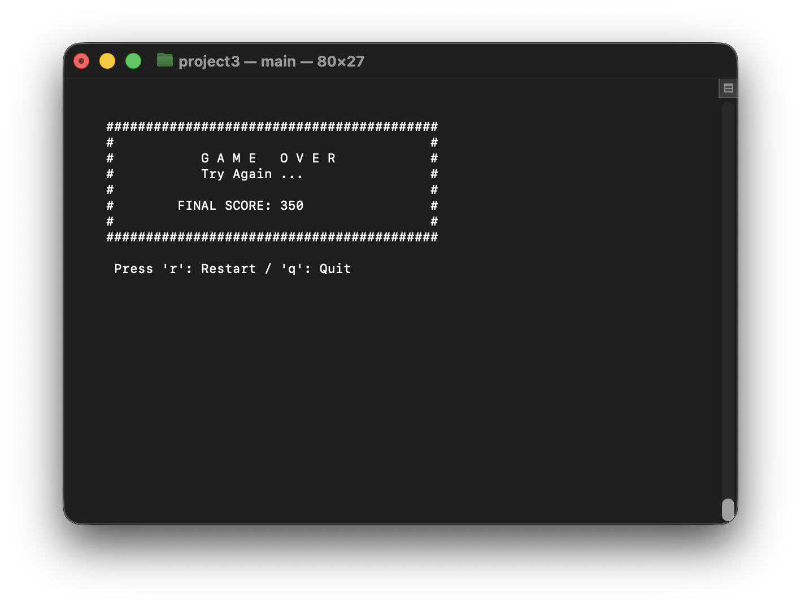

---

## 7. 느낀 점

### 7.1. 성과 및 배운 점
- **크로스 플랫폼 달성**: 제공된 초기 버전의 소스 코드로 Windows와 Linux/macOS 환경에서 모두 컴파일 및 실행 가능한 게임을 완성하였다.
- **게임 기능 추가**: 단순 이동뿐만 아니라 생명력, 점수, 스테이지 시스템을 도입하여 정상적인 게임의 형태를 갖추었다.
- **전처리기 활용**: `#ifdef` 구문을 통해 OS 종속적인 코드를 분리하고 관리하는 기법을 익혔다.
- **코드 분석 능력 향상**: 기존에 제공된 코드를 분석하고 더 나아가 게임성을 향상 할 수 있는 능력을 기를 수 있었다.
- **GitHub 숙달**: 각 조원의 역할마다 브랜치를 구성하여 해당 기능에 커밋하고 공동 작업 브랜치`test`에 _merge_ 를 하여 협업 능력을 향상할 수 있었다.

---

## 8. 참고 문헌
- [너구리 게임 나무위키](https://namu.wiki/w/%EB%84%88%EA%B5%AC%EB%A6%AC(%EA%B2%8C%EC%9E%84))
- [ANSI 코드표](https://eteo.tistory.com/746)
- [Window ansi 활성화](https://stackoverflow.com/questions/52607960/how-can-i-enable-virtual-terminal-processing)
- [markdown 문법](https://gist.github.com/ihoneymon/652be052a0727ad59601)
- [Beep 함수](https://blog.naver.com/ndb796/220576603438)
- [fseek, ftell 함수](https://coding-by-head.tistory.com/entry/cstdlib-file-pointer)
